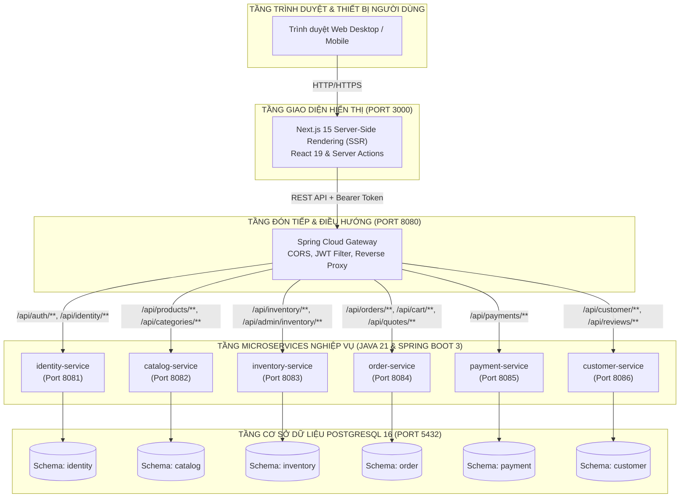
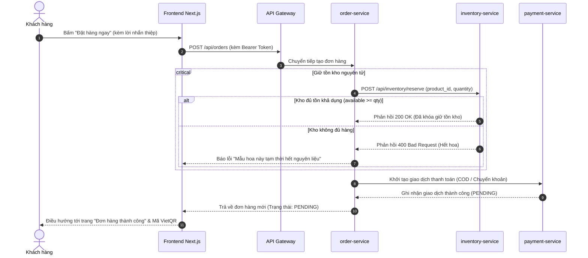

# FLORA — NỀN TẢNG THƯƠNG MẠI ĐIỆN TỬ HOA TƯƠI NGHỆ THUẬT & QUÀ TẶNG CAO CẤP
# BÁO CÁO MÔ TẢ CHI TIẾT ĐỀ TÀI (COMPREHENSIVE PROJECT SPECIFICATION)

---

## MỤC LỤC CHI TIẾT
- [CHƯƠNG 1: TỔNG QUAN ĐỀ TÀI & KHẢO SÁT NGHIỆP VỤ](#chương-1-tổng-quan-đề-tài--khảo-sát-nghiệp-vụ)
  - [1.1. Bối cảnh thị trường và lý do chọn đề tài](#11-bối-cảnh-thị-trường-và-lý-do-chọn-đề-tài)
  - [1.2. Phân tích các thách thức đặc thù của ngành hoa tươi](#12-phân-tích-các-thách-thức-đặc-thù-của-ngành-hoa-tươi)
  - [1.3. Mục tiêu và phạm vi nghiên cứu](#13-mục-tiêu-và-phạm-vi-nghiên-cứu)
  - [1.4. Các nhóm đối tượng sử dụng hệ thống (User Roles)](#14-các-nhóm-đối-tượng-sử-dụng-hệ-thống-user-roles)
- [CHƯƠNG 2: PHÂN TÍCH & THIẾT KẾ KIẾN TRÚC HỆ THỐNG](#chương-2-phân-tích--thiết-kế-kiến-trúc-hệ-thống)
  - [2.1. Đặt vấn đề: Tại sao chọn Microservices thay vì Monolith?](#21-đặt-vấn-đề-tại-sao-chọn-microservices-thay-vì-monolith)
  - [2.2. Sơ đồ kiến trúc tổng thể (System Topology)](#22-sơ-đồ-kiến-trúc-tổng-thể-system-topology)
  - [2.3. Cơ chế giao tiếp an toàn giữa các dịch vụ](#23-cơ-chế-giao-tiếp-an-toàn-giữa-các-dịch-vụ)
  - [2.4. Kiến trúc cơ sở dữ liệu: Database-per-service & Multi-Schema](#24-kiến-trúc-cơ-sở-dữ-liệu-database-per-service--multi-schema)
  - [2.5. Chiến lược quản lý cấu trúc bảng với Flyway Migration](#25-chiến-lược-quản-lý-cấu-trúc-bảng-với-flyway-migration)
- [CHƯƠNG 3: THIẾT KẾ CHI TIẾT CÁC MICROSERVICES BACKEND](#chương-3-thiết-kế-chi-tiết-các-microservices-backend)
  - [3.1. API Gateway (Spring Cloud Gateway)](#31-api-gateway-spring-cloud-gateway)
  - [3.2. Identity Service (Xác thực & Phân quyền RBAC)](#32-identity-service-xác-thực--phân-quyền-rbac)
  - [3.3. Catalog Service (Quản lý sản phẩm & Phân loại 110+ loài hoa)](#33-catalog-service-quản-lý-sản-phẩm--phân-loại-110-loài-hoa)
  - [3.4. Inventory Service (Quản lý tồn kho hoa tươi & Giữ hàng nguyên tử)](#34-inventory-service-quản-lý-tồn-kho-hoa-tươi--giữ-hàng-nguyên-tử)
  - [3.5. Order Service (Giỏ hàng, Báo giá Realtime & Vòng đời đơn hàng)](#35-order-service-giỏ-hàng-báo-giá-realtime--vòng-đời-đơn-hàng)
  - [3.6. Payment Service (Thanh toán đa kênh & Xác nhận giao dịch)](#36-payment-service-thanh-toán-đa-kênh--xác-nhận-giao-dịch)
  - [3.7. Customer Service (Hồ sơ, Wishlist & Đánh giá sản phẩm)](#37-customer-service-hồ-sơ-wishlist--đánh-giá-sản-phẩm)
- [CHƯƠNG 4: THIẾT KẾ FRONTEND & TRẢI NGHIỆM NGƯỜI DÙNG (UX/UI)](#chương-4-thiết-kế-frontend--trải-nghiệm-người-dùng-uxui)
  - [4.1. Kiến trúc Next.js 15 App Router & React 19](#41-kiến-trúc-nextjs-15-app-router--react-19)
  - [4.2. Chiến lược tối ưu hiệu năng & Khả năng chịu lỗi (Fault-Tolerance)](#42-chiến-lược-tối-ưu-hiệu-năng--khả-năng-chịu-lỗi-fault-tolerance)
  - [4.3. Hệ thống thiết kế nhận diện thương hiệu (Design System)](#43-hệ-thống-thiết-kế-nhận-diện-thương-hiệu-design-system)
  - [4.4. Phân hệ các màn hình chức năng](#44-phân-hệ-các-màn-hình-chức-năng)
- [CHƯƠNG 5: CÁC QUY TRÌNH NGHIỆP VỤ CỐT LÕI (CORE BUSINESS WORKFLOWS)](#chương-5-các-quy-trình-nghiệp-vụ-cốt-lõi-core-business-workflows)
  - [5.1. Luồng đặt hàng và khóa giữ tồn kho nguyên tử](#51-luồng-đặt-hàng-và-khóa-giữ-tồn-kho-nguyên-tử)
  - [5.2. Luồng hủy đơn hàng và hoàn trả tồn kho](#52-luồng-hủy-đơn-hàng-và-hoàn-trả-tồn-kho)
  - [5.3. Động cơ tính giá & Áp dụng voucher khuyến mãi đa tầng](#53-động-cơ-tính-giá--áp-dụng-voucher-khuyến-mãi-đa-tầng)
  - [5.4. Quy trình đánh giá chất lượng có xác thực người mua](#54-quy-trình-đánh-giá-chất-lượng-có-xác-thực-người-mua)
- [CHƯƠNG 6: ĐÓNG GÓI, DEVOPS & KIỂM THỬ HỆ THỐNG](#chương-6-đóng-gói-devops--kiểm-thử-hệ-thống)
  - [6.1. Đóng gói Container với Docker Multi-Stage Builds](#61-đóng-gói-container-với-docker-multi-stage-builds)
  - [6.2. Điều phối cụm dịch vụ với Docker Compose](#62-điều-phối-cụm-dịch-vụ-với-docker-compose)
  - [6.3. Chiến lược kiểm thử tự động (Testing Strategy)](#63-chiến-lược-kiểm-thử-tự-động-testing-strategy)
- [CHƯƠNG 7: KẾT LUẬN & HƯỚNG PHÁT TRIỂN](#chương-7-kết-luận--hướng-phát-triển)
  - [7.1. Đánh giá kết quả đạt được](#71-đánh-giá-kết-quả-đạt-được)
  - [7.2. Các điểm hạn chế cần cải thiện](#72-các-điểm-hạn-chế-cần-cải-thiện)
  - [7.3. Hướng nghiên cứu & Mở rộng trong tương lai](#73-hướng-nghiên-cứu--mở-rộng-trong-tương-lai)

---

## CHƯƠNG 1: TỔNG QUAN ĐỀ TÀI & KHẢO SÁT NGHIỆP VỤ

### 1.1. Bối cảnh thị trường và lý do chọn đề tài
Trong kỷ nguyên số, thương mại điện tử (TMĐT) đã thâm nhập sâu rộng vào mọi khía cạnh tiêu dùng. Tuy nhiên, phần lớn các nền tảng TMĐT hiện hành (Shopee, Lazada, TikTok Shop) được thiết kế cho các mặt hàng tiêu chuẩn, đóng gói sẵn và bảo quản lâu (quần áo, mỹ phẩm, đồ gia dụng).

Ngược lại, **thị trường hoa tươi nghệ thuật và quà tặng cao cấp** mang những đặc tính rất riêng biệt:
- Sản phẩm có tính nghệ thuật, tính thẩm mỹ cao và được cá nhân hóa mạnh mẽ theo từng người nhận.
- Đòi hỏi sự gắn kết tinh tế giữa người tặng và người nhận thông qua thiệp tay, dải ruy băng chúc mừng, banner khai trương.
- Khách hàng thường có nhu cầu phát sinh khẩn cấp (ngày sinh nhật người thân, lễ kỷ niệm tình yêu, hoa viếng tang lễ, sự kiện chúc mừng đối tác) đòi hỏi thời gian giao nhận tính bằng giờ thay vì bằng ngày.

Xuất phát từ thực tế đó, đề tài **"Nghiên cứu, thiết kế và phát triển Nền tảng Thương mại Điện tử Hoa tươi Nghệ thuật FLORA theo kiến trúc Microservices"** được thực hiện nhằm cung cấp một giải pháp chuyên biệt hóa (Vertical E-Commerce), nâng cao trải nghiệm mua sắm hoa tươi trực tuyến và tối ưu hóa quy trình quản trị tiệm hoa hiện đại.

---

### 1.2. Phân tích các thách thức đặc thù của ngành hoa tươi

Khi số hóa chuỗi bán lẻ hoa tươi, đội ngũ phát triển phải đối mặt với 5 bài toán kỹ thuật & nghiệp vụ hóc búa:

1. **Hàng hóa mau hỏng (Perishable Goods) & Bán vượt tồn kho (Over-selling)**:
   - Hoa tươi không thể lưu trữ vô thời hạn. Hoa cắt cành tại tiệm chỉ có tuổi thọ đẹp nhất từ 1-3 ngày.
   - Thợ cắm hoa chỉ bắt tay vào hoàn thiện sản phẩm sau khi đơn được xác nhận. Nếu hệ thống cho phép 2 khách hàng cùng đặt một mẫu hoa sử dụng loại hoa hiếm (ví dụ: Hoa mẫu đơn trắng Peony) trong khi kho chỉ còn đủ nguyên liệu cho 1 đơn, tiệm hoa sẽ rơi vào khủng hoảng vận hành. Do đó, hệ thống bắt buộc phải có cơ chế **khóa giữ tồn kho nguyên tử (`Atomic Stock Hold`)** ngay khi đơn được tạo.
2. **Cam kết giao hàng hỏa tốc trong 2 giờ**:
   - Khách đặt hoa thường cần giao gấp trong ngày. Hệ thống phải phân định rõ ràng các mốc thời gian giao hẹn trước (giao 2h, giao theo ca sáng/chiều/tối) và chuyển trạng thái tức thời cho nhân viên chuẩn bị.
3. **Cá nhân hóa sản phẩm & Thông điệp trao gửi**:
   - Đơn mua hoa không chỉ có địa chỉ người mua, mà còn có thông tin người nhận (tên, số điện thoại, địa chỉ nhận hộ), nội dung viết thiệp chúc mừng, thông điệp in banner, và yêu cầu chụp hình hoa thực tế gửi khách duyệt trước khi giao xe.
4. **Hệ thống phân loại hoa đa chiều (Multifaceted Taxonomy)**:
   - Khách mua hoa có thói quen tìm kiếm rất đa dạng: người tìm theo Dịp (Khai trương, Sinh nhật, Tình yêu), người tìm theo Kiểu dáng thiết kế (Hoa bó, Giỏ hoa, Kệ hoa 2 tầng, Hộp hoa nghệ thuật, Chậu lan hồ điệp), người tìm theo Màu sắc phong thủy (Đỏ, Vàng, Hồng, Pastel, Trắng, Tím), và đặc biệt là người sành hoa tìm kiếm theo chính xác **Giống hoa** (Hồng David Austin Juliet, Cát tường Nhật, Phi yến xanh, Cúc mẫu đơn...).
5. **Định giá đa tầng và khuyến mãi linh hoạt**:
   - Giá hoa tươi biến động theo mùa và các dịp lễ lớn (Valentine, 8/3, 20/10). Hệ thống cần hỗ trợ hiển thị giá niêm yết gốc kèm giá khuyến mãi, đồng thời kết hợp linh hoạt công cụ voucher chiết khấu.

---

### 1.3. Mục tiêu và phạm vi nghiên cứu

#### 1.3.1. Mục tiêu đề tài
- **Về mặt công nghệ**:
  - Áp dụng thành công mô hình kiến trúc **Microservices chuẩn Domain-Driven Design (DDD)**.
  - Sử dụng các công nghệ mới nhất: **Java 21 LTS**, **Spring Boot 3.4.5**, **Spring Cloud Gateway**, **PostgreSQL 16**, **Next.js 15 (App Router)**, **React 19**, **TypeScript**.
  - Xây dựng mô hình cơ sở dữ liệu độc lập **Database-per-service** với 6 logical schemas, đảm bảo tính toàn vẹn và khả năng mở rộng (Scalability).
  - Tự động hóa hoàn toàn quy trình đóng gói và điều phối dịch vụ thông qua **Docker & Docker Compose**.
- **Về mặt nghiệp vụ**:
  - Xây dựng hoàn chỉnh chu trình khép kín: Khám phá sản phẩm ➔ Giỏ hàng & Báo giá ➔ Đặt hàng & Giữ kho ➔ Thanh toán ➔ Điều phối cắm hoa & Giao vận ➔ Đánh giá & Chăm sóc khách hàng.

#### 1.3.2. Phạm vi đề tài
- Hệ thống tập trung giải quyết phân hệ bán lẻ hoa tươi nghệ thuật, quà tặng và dịch vụ giao hoa tận nơi tại các đô thị lớn.
- Triển khai đầy đủ trên môi trường Local Development và Containerized Production-Ready Environment.

---

### 1.4. Các nhóm đối tượng sử dụng hệ thống (User Roles)

Hệ thống thiết kế phân quyền theo chuẩn RBAC (Role-Based Access Control) với 3 nhóm người dùng:

| Vai trò | Nhóm đối tượng | Trách nhiệm & Quyền hạn |
| :--- | :--- | :--- |
| **`CUSTOMER`** | Khách hàng mua sắm | Tìm kiếm & lọc hoa, quản lý giỏ hàng, đặt hàng giao 2h, thanh toán COD / VietQR, theo dõi trạng thái đơn hàng, lưu hoa yêu thích (Wishlist), viết đánh giá sao sau khi nhận hoa. |
| **`STAFF`** | Nhân viên tiệm / Florist | Tiếp nhận đơn hàng mới theo thời gian thực, in thông tin thiệp chúc mừng, cập nhật tiến độ cắm hoa (`CONFIRMED` ➔ `PROCESSING` ➔ `SHIPPING` ➔ `DELIVERED`), xác nhận biên lai chuyển khoản ngân hàng. |
| **`ADMIN`** | Quản trị viên cửa hàng | Xem báo cáo doanh thu & KPI tiệm hoa, quản lý danh mục sản phẩm và giá bán (giá gốc, giá ưu đãi), quản lý kho hoa (nhập/xuất/điều chỉnh tồn kho), phát hành và kiểm soát mã giảm giá (Vouchers). |

---

## CHƯƠNG 2: PHÂN TÍCH & THIẾT KẾ KIẾN TRÚC HỆ THỐNG

### 2.1. Đặt vấn đề: Tại sao chọn Microservices thay vì Monolith?

Trong các hệ thống thương mại điện tử truyền thống (Monolithic Architecture), toàn bộ mã nguồn từ catalog, giỏ hàng, thanh toán đến tồn kho đều nằm trong một khối ứng dụng duy nhất. Mô hình này bộc lộ nhiều điểm yếu chí mạng khi áp dụng cho ngành hoa tươi:
- **Nghẽn cổ chai vào dịp cao điểm (Peak Traffic Bottleneck)**: Vào các ngày lễ lớn (14/2, 8/3, 20/10), lượng truy cập xem mẫu hoa tăng gấp 20-50 lần, trong khi số lượt thanh toán thực tế chỉ tăng 3-5 lần. Với Monolith, việc scale phải nhân bản toàn bộ ứng dụng cồng kềnh. Với Microservices, ta có thể scale độc lập chỉ riêng `catalog-service` và `inventory-service`.
- **Rủi ro sập dây chuyền (Single Point of Failure)**: Nếu module thanh toán gặp sự cố trong Monolith, toàn bộ website xem hoa cũng bị tê liệt. Trong Microservices, nếu cổng thanh toán gặp trục trặc, khách hàng vẫn có thể tra cứu thông tin sản phẩm và chọn phương thức thanh toán COD hoặc chuyển khoản ngân hàng bình thường.
- **Sự cô lập dữ liệu (Data Isolation)**: Nghiệp vụ tồn kho và quản lý đơn hàng có tính giao dịch khắt khe (`ACID`), trong khi catalog hoa cần tốc độ đọc nhanh (`High Read Throughput`). Việc phân tách thành các dịch vụ độc lập giúp tối ưu hóa cấu hình database riêng cho từng miền nghiệp vụ.

---

### 2.2. Sơ đồ kiến trúc tổng thể (System Topology)

Hệ thống FLORA được cấu thành từ 9 container chuyên biệt, phối hợp thông qua mạng nội bộ Docker (`flora-network`):



---

### 2.3. Cơ chế giao tiếp an toàn giữa các dịch vụ

Hệ thống thiết lập 2 vành đai bảo mật rõ ràng:

1. **Vành đai bên ngoài (North-South Communication)**:
   - Toàn bộ lưu lượng từ Client gửi đến cổng 8080 của API Gateway.
   - API Gateway xác thực chữ ký số của **JWT Bearer Token** bằng thuật toán HMAC-SHA256. Nếu hợp lệ, Gateway trích xuất thông tin người dùng (`sub`, `roles`) và chuyển tiếp xuống backend service kèm HTTP Header an toàn.
   - Xử lý CORS tập trung, cho phép nguồn tin cậy từ frontend (`http://localhost:3000`).

2. **Vành đai nội bộ (East-West Communication)**:
   - Khi một microservice cần gọi trực tiếp tới microservice khác (ví dụ: `order-service` gọi `inventory-service` để giữ kho hoặc gọi `catalog-service` để lấy giá chuẩn), cuộc gọi được bảo vệ bằng header bí mật:
     `X-Internal-Key: <SECRET_INTERNAL_KEY>`
   - Các API nội bộ này không được định tuyến qua Gateway ra bên ngoài Internet, ngăn ngừa hoàn toàn nguy cơ kẻ xấu tấn công bypass quyền hạn.

---

### 2.4. Kiến trúc cơ sở dữ liệu: Database-per-service & Multi-Schema

Thay vì chạy 6 máy chủ database riêng biệt gây lãng phí tài nguyên RAM trên môi trường triển khai vừa và nhỏ, FLORA áp dụng kiến trúc **PostgreSQL 16 Multi-Schema**:
- Một cụm database PostgreSQL 16 duy nhất (tên DB: `flora`).
- Mỗi microservice sở hữu một **Logical Schema** độc lập:
  1. `identity`: Tài khoản, mật khẩu băm, vai trò người dùng.
  2. `catalog`: Sản phẩm, danh mục, giống hoa (110+ loài), màu sắc, dịp tặng, hình ảnh sản phẩm.
  3. `inventory`: Bản ghi tồn kho từng sản phẩm hoa, lịch sử biến động kho (`stock_movements`).
  4. `order`: Giỏ hàng, đơn hàng, chi tiết đơn hàng, lịch sử trạng thái, danh mục vouchers.
  5. `payment`: Giao dịch thanh toán, phương thức thanh toán, nhật ký đối soát.
  6. `customer`: Thông tin cá nhân, sổ địa chỉ nhận hoa, danh sách yêu thích (`wishlists`), nhận xét đánh giá (`reviews`).
- **Nguyên tắc bất khả xâm phạm**: Không có khóa ngoại xuyên Schema (No Cross-Schema Foreign Keys). Dữ liệu được liên kết lỏng thông qua UUID định danh.

---

### 2.5. Chiến lược quản lý cấu trúc bảng với Flyway Migration

Để loại bỏ hoàn toàn việc chỉnh sửa database bằng tay và đảm bảo môi trường phát triển giống hệt môi trường thực tế:
- Mỗi microservice tích hợp công cụ **Flyway Migration**.
- Khi microservice khởi động, Flyway tự động đọc các file script SQL (`V1__...sql`, `V2__...sql`, `V3__...sql`...) trong thư mục `src/main/resources/db/migration/` và so sánh mã băm (checksum) với bảng lịch sử `flyway_schema_history` của schema đó.
- Cấu trúc bảng và dữ liệu mẫu (110+ loài hoa, 20 sản phẩm hoa thực tế, danh mục, dịp tặng) được nạp tự động, chuẩn xác 100%.

---

## CHƯƠNG 3: THIẾT KẾ CHI TIẾT CÁC MICROSERVICES BACKEND

### 3.1. API Gateway (Spring Cloud Gateway)
- **Cổng dịch vụ (Port)**: `8080`
- **Công nghệ**: Spring Cloud Gateway 3.4.5 xây dựng trên nền WebFlux không phong bế (Non-blocking Reactive Netty).
- **Trách nhiệm chính**:
  - Đóng vai trò là điểm truy cập duy nhất cho toàn bộ hệ thống.
  - Phân tích URL và chuyển tiếp request đến microservice tương ứng.
  - Kiểm soát chính sách CORS tập trung: Cho phép các phương thức `GET, POST, PUT, DELETE, PATCH, OPTIONS`.
  - Cung cấp trang thử nghiệm Swagger UI tập trung để tra cứu tài liệu API của toàn bộ hệ thống.

---

### 3.2. Identity Service (Xác thực & Phân quyền RBAC)
- **Cổng dịch vụ (Port)**: `8081` — **Schema**: `identity`
- **Trách nhiệm chính**:
  - Đăng ký tài khoản mới cho khách hàng với validation định dạng email và mật khẩu tối thiểu 8 ký tự.
  - Mã hóa mật khẩu một chiều bằng thuật toán **BCrypt** với hệ số muối (salt rounds) an toàn.
  - Cung cấp cơ chế đăng nhập, phát hành token **JWT (JSON Web Token)** với thời hạn sống định sẵn (hỗ trợ kiểm tra phiên đăng nhập tức thời).
  - Cung cấp API `GET /api/auth/me` để frontend xác thực phiên làm việc và hiển thị tên người dùng trên thanh điều hướng.

---

### 3.3. Catalog Service (Quản lý sản phẩm & Phân loại 110+ loài hoa)
- **Cổng dịch vụ (Port)**: `8082` — **Schema**: `catalog`
- **Trách nhiệm chính**:
  - Quản lý danh mục hoa: Hoa bó, Giỏ hoa tươi, Kệ hoa khai trương, Hộp hoa nghệ thuật, Chậu lan hồ điệp.
  - Quản lý **Hệ thống phân loại thực vật học 110+ loài hoa**: Tích hợp các loài hoa biểu tượng như *Hồng David Austin (Juliet, Pink O'Hara), Mẫu đơn Peony, Cát tường, Phi yến, Cúc Tana, Hoa sen Bách Diệp, Lan hồ điệp, Cẩm chướng...*
  - **Cơ chế định giá 2 tầng**: Mỗi sản phẩm hỗ trợ 2 trường giá trị số học:
    - `original_price` (Giá gốc niêm yết)
    - `price` (Giá bán ưu đãi thực tế)
  - Bộ lọc sản phẩm đa diện kết hợp: Từ khóa tìm kiếm, lọc theo Slug danh mục, lọc theo Dịp tặng, lọc theo Giống hoa, lọc theo Bảng màu sắc, lọc theo Ngân sách linh hoạt.

---

### 3.4. Inventory Service (Quản lý tồn kho hoa tươi & Giữ hàng nguyên tử)
- **Cổng dịch vụ (Port)**: `8083` — **Schema**: `inventory`
- **Trách nhiệm chính**:
  - Quản lý số lượng tồn kho từng mẫu hoa theo thời gian thực.
  - **Bộ 3 chỉ số tồn kho**:
    > Tồn khả dụng (available) = Tồn thực tế (on_hand) - Tồn đang giữ (reserved)
  - **Quy trình giữ hàng nguyên tử (`reserve`)**:
    - Khi khách bấm thanh toán đơn hàng, `order-service` gửi yêu cầu giữ hàng.
    - `inventory-service` kiểm tra: Nếu `available >= số lượng đặt`, tăng `reserved` tương ứng. Nếu không đủ, từ chối ngay lập tức để tránh bán vượt tồn kho.
  - **Quy trình hoàn tất (`commit`) & Hủy giữ (`release`)**:
    - Khi đơn hàng hoàn tất hoặc thanh toán thành công, chuyển lượng `reserved` thành trừ thực tế `on_hand`.
    - Khi đơn hàng bị hủy hoặc quá thời hạn thanh toán, giảm lượng `reserved` để hoàn trả tồn khả dụng về trạng thái sẵn sàng bán.

---

### 3.5. Order Service (Giỏ hàng, Báo giá Realtime & Vòng đời đơn hàng)
- **Cổng dịch vụ (Port)**: `8084` — **Schema**: `order`
- **Trách nhiệm chính**:
  - **Giỏ hàng trực tuyến**: Lưu trữ danh sách sản phẩm, số lượng của từng khách hàng.
  - **Công cụ báo giá tức thời (`Quote Engine`)**: Tính toán chính xác tổng tiền hàng, tiền ship hỏa tốc 2 giờ, số tiền chiết khấu từ voucher.
  - **Động cơ mã giảm giá (`Voucher Engine`)**: Quản lý các voucher khuyến mãi (ví dụ: `FLORA2026`, `CHAOXUAN20`, `FREESHIP`), kiểm tra ngày hiệu lực, giá trị đơn hàng tối thiểu và giới hạn mức giảm tối đa.
  - **Vòng đời đơn hàng (State Machine 6 trạng thái)**:
    ```
    PENDING (Chờ xác nhận) 
      ➔ CONFIRMED (Đã tiếp nhận) 
      ➔ PROCESSING (Thợ đang cắm hoa) 
      ➔ SHIPPING (Đang giao hỏa tốc 2h) 
      ➔ DELIVERED (Đã giao thành công)
      [Hoặc CANCELLED - Đã hủy đơn]
    ```

---

### 3.6. Payment Service (Thanh toán đa kênh & Xác nhận giao dịch)
- **Cổng dịch vụ (Port)**: `8085` — **Schema**: `payment`
- **Trách nhiệm chính**:
  - Hỗ trợ đa dạng phương thức thanh toán phù hợp thị trường Việt Nam:
    - **`COD` (Thanh toán tiền mặt khi nhận hoa)**: Khách kiểm tra hoa tận tay rồi mới thanh toán.
    - **`BANK_TRANSFER` (Chuyển khoản VietQR)**: Tự động hiển thị mã QR kèm nội dung chuyển khoản chuẩn cú pháp `FLORA-{orderId}`.
    - **`ONLINE_GATEWAY` (Thanh toán thẻ/Ví điện tử)**: Mô phỏng xác thực thanh toán tức thì.
  - Ghi nhận trạng thái thanh toán (`PENDING`, `COMPLETED`, `FAILED`, `REFUNDED`) và đồng bộ ngược về `order-service`.

---

### 3.7. Customer Service (Hồ sơ, Wishlist & Đánh giá sản phẩm)
- **Cổng dịch vụ (Port)**: `8086` — **Schema**: `customer`
- **Trách nhiệm chính**:
  - Quản lý hồ sơ khách hàng, cập nhật số điện thoại và lưu sổ địa chỉ giao hoa mặc định.
  - **Danh sách yêu thích (Wishlist)**: Cho phép khách hàng thả tim lưu lại những bó hoa đẹp để xem lại và đặt mua sau.
  - **Đánh giá & Xếp hạng sản phẩm (Product Reviews)**: Khách hàng đánh giá số sao (1 đến 5 sao) và để lại bình luận cảm nhận. Có cơ chế ràng buộc bảo vệ: Chỉ những khách hàng đã thực sự nhận hàng thành công mới được phép gửi đánh giá.

---

## CHƯƠNG 4: THIẾT KẾ FRONTEND & TRẢI NGHIỆM NGƯỜI DÙNG (UX/UI)

### 4.1. Kiến trúc Next.js 15 App Router & React 19

Frontend được xây dựng bằng công nghệ hiện đại nhất hiện nay:
- **Next.js 15 App Router**: Tận dụng triệt để mô hình **React Server Components (RSC)**. Các trang danh mục, chi tiết sản phẩm được render trực tiếp từ server, giảm thiểu tối đa lượng JavaScript phải tải xuống trình duyệt, giúp website tải nhanh như chớp và tối ưu SEO tuyệt đối trên Google Search.
- **Server Actions**: Các thao tác tương tác như thêm vào giỏ hàng (`addToCart`), cập nhật số lượng, áp dụng voucher, thay đổi trạng thái đơn hàng đều được xử lý an toàn qua Server Actions, không để lộ logic API nội bộ ra Client-side.
- **TypeScript 5.8**: Định nghĩa kiểu dữ liệu chặt chẽ từ Product, CartItem, Order, Category đến các Event handler, triệt tiêu hoàn toàn các lỗi runtime bất ngờ (`undefined is not a function`).

---

### 4.2. Chiến lược tối ưu hiệu năng & Khả năng chịu lỗi (Fault-Tolerance)

Trong quá trình vận hành thực tế trên môi trường Docker, độ trễ mạng giữa các container có thể xảy ra. FLORA áp dụng giải pháp chịu lỗi nâng cao:
- **`Promise.allSettled` thay cho `Promise.all`**: Tại trang chủ và trang danh mục, hệ thống gọi đồng thời nhiều dịch vụ để lấy dữ liệu. Nếu sử dụng `Promise.all` thông thường, chỉ cần một API phụ bị trễ sẽ kéo sập toàn bộ trang. Với `Promise.allSettled`, hệ thống vẫn hiển thị 100% các dữ liệu đã lấy thành công, đảm bảo khách hàng luôn thấy sản phẩm hoa tươi.
- **Nới lỏng Timeout an toàn (15.000ms)**: Đảm bảo các kết nối trong lần khởi động đầu tiên (Cold Start) của Spring Boot và PostgreSQL không bị cắt đứt đột ngột.
- **CSS Tinh gọn không phụ thuộc thư viện nặng**: Sử dụng CSS thuần hiện đại (CSS Variables, Flexbox, CSS Grid) thay vì nhúng các framework cồng kềnh, giúp file stylesheet chỉ nặng vài chục KB.

---

### 4.3. Hệ thống thiết kế nhận diện thương hiệu (Design System)

Giao diện được thiết kế theo phong cách tối giản thanh lịch (Elegant Floral Aesthetics):
- **Bảng màu nhận diện**:
  - *Màu chủ đạo (Primary Forest Green)*: `#183D2D` — Tượng trưng cho lá xanh, thiên nhiên và sự cao cấp.
  - *Màu nhấn (Peach / Dusty Rose)*: `#E28B78` — Tượng trưng cho những cánh hoa tươi tắn, ấm áp.
  - *Màu nền (Warm Off-white / Cream)*: `#FBF9F5` — Mang lại cảm giác dễ chịu, tinh tế cho mắt khi duyệt ảnh hoa.
  - *Màu bề mặt thẻ (Clean Card White)*: `#FFFFFF` kết hợp bo góc mềm mại (`border-radius: 16px`) và đổ bóng mờ (`box-shadow: 0 4px 20px rgba(0,0,0,0.05)`).
- **Bộ Typography chuẩn quốc tế**:
  - Tiêu đề & Logo: Phông chữ sans-serif hiện đại **Plus Jakarta Sans** (Weights: 600, 700, 800).
  - Nội dung & Thuyết minh: Phông chữ tiếng Việt chuẩn xác **Be Vietnam Pro** (Weights: 400, 500).

---

### 4.4. Phân hệ các màn hình chức năng

1. **Màn hình Trang chủ (`/`)**:
   - Hero banner nghệ thuật với cam kết giao hoa hỏa tốc 2 giờ và đánh giá 4.9/5 sao.
   - Thanh điều hướng nhanh theo Dịp trao tặng (Sinh nhật, Tình yêu, Khai trương, Cảm ơn, Hoa cưới, Chia buồn).
   - Danh sách sản phẩm hoa tươi bán chạy nhất kèm nhãn giảm giá và nút đặt mua nhanh.
2. **Màn hình Danh mục & Bộ lọc (`/san-pham`)**:
   - Thanh bộ lọc faceted filter bên sườn (Sidebar):
     - Ô tìm kiếm tức thời theo tên hoa và ý nghĩa.
     - Lọc theo kiểu dáng thiết kế kèm số lượng mẫu sẵn có.
     - Bảng màu sắc tương tác trực quan (Cam, Hồng, Trắng, Tím, Vàng, Xanh, Đỏ).
     - Bộ chọn nhanh 110+ loài hoa & phụ liệu cao cấp.
     - Bộ lọc ngân sách nhanh (Dưới 500k, 500k - 1tr, Trên 1tr) và nhập khoảng giá tùy chỉnh.
   - Sắp xếp sản phẩm thông minh: Mới nhất, Giá tăng dần, Giá giảm dần, Tên A-Z.
3. **Màn hình Chi tiết sản phẩm (`/san-pham/[id]`)**:
   - Bộ sưu tập ảnh hoa độ phân giải cao, hiển thị rõ giá gốc và giá ưu đãi.
   - Thông số kích thước hoa (Chiều cao, Chiều rộng, Trọng lượng) giúp khách hình dung chính xác quy cách bó hoa.
   - Danh sách các giống hoa thành phần có trong thiết kế.
   - Nút "Thêm vào giỏ hàng", nút "Yêu thích" và khối cam kết đổi trả bảo hành.
4. **Màn hình Giỏ hàng & Thanh toán (`/gio-hang`, `/thanh-toan`)**:
   - Xem lại danh sách hoa đã chọn, điều chỉnh số lượng tức thời.
   - Nhập thông tin người nhận, lời nhắn thiệp chúc mừng, banner khai trương.
   - Nhập mã giảm giá Voucher, xem chiết khấu trừ trực tiếp vào tổng bill.
   - Chọn phương thức thanh toán: COD hoặc quét mã Chuyển khoản VietQR.
5. **Màn hình Danh sách yêu thích (`/yeu-thich`)**:
   - Quản lý những mẫu hoa yêu thích mà khách hàng đã bấm thả tim.
6. **Màn hình Nhân viên tiệm (`/nhan-vien`)**:
   - Bảng quản lý đơn hàng chuyên dụng cho Florist và nhân viên vận chuyển.
   - Xem chi tiết nội dung thiệp tay cần viết, địa chỉ nhận và số điện thoại người nhận.
   - Cập nhật nhanh trạng thái: Đã xác nhận ➔ Đang cắm hoa ➔ Đang giao xe ➔ Đã giao xong.
7. **Màn hình Quản trị viên (`/admin`)**:
   - Bảng điều khiển KPI: Tổng doanh thu, số đơn thành công, tổng sản phẩm trong hệ thống.
   - Quản lý danh mục hoa & cập nhật giá bán.
   - Quản lý xuất nhập tồn kho hoa tươi.
   - Phát hành và theo dõi hiệu lực của các mã Voucher khuyến mãi.

---

## CHƯƠNG 5: CÁC QUY TRÌNH NGHIỆP VỤ CỐT LÕI (CORE BUSINESS WORKFLOWS)

### 5.1. Luồng đặt hàng và khóa giữ tồn kho nguyên tử



---

### 5.2. Luồng hủy đơn hàng và hoàn trả tồn kho

Khi khách hàng yêu cầu hủy đơn hoặc đơn hàng quá thời hạn thanh toán quy định:
1. `order-service` tiếp nhận yêu cầu hủy và kiểm tra điều kiện (Đơn hàng chỉ được phép hủy khi đang ở trạng thái `PENDING` hoặc `CONFIRMED`, chưa tiến hành cắm hoa `PROCESSING`).
2. `order-service` chuyển trạng thái đơn hàng sang `CANCELLED`.
3. `order-service` gửi yêu cầu nội bộ sang `inventory-service`:
   `POST /api/inventory/release` kèm theo `product_id` và số lượng.
4. `inventory-service` giảm chỉ số `reserved` tương ứng, hoàn trả lại số hoa về `available` để khách hàng khác có thể đặt mua ngay lập tức.

---

### 5.3. Động cơ tính giá & Áp dụng voucher khuyến mãi đa tầng

Để đảm bảo tính minh bạch và độ chính xác tài chính tuyệt đối:
- **Nguyên tắc xử lý tiền tệ**: Toàn bộ các giá trị tài chính trong hệ thống đều được lưu trữ dưới dạng kiểu số thực chính xác cao **`BigDecimal`** trong Java và **`NUMERIC(19,2)`** trong cơ sở dữ liệu PostgreSQL. Tuyệt đối không sử dụng `float` hoặc `double` để tránh sai số làm tròn tiền tệ.
- **Công thức tính hóa đơn cuối cùng**:
  ```
  Tổng thanh toán = (Tổng tiền hàng) + (Phí ship hỏa tốc) - (Chiết khấu Voucher)
  ```
- **Kiểm tra hợp lệ Voucher**:
  1. Mã voucher phải đang ở trạng thái `ACTIVE`.
  2. Thời điểm áp dụng phải nằm trong khoảng `valid_from` đến `valid_to`.
  3. Tổng tiền hàng phải đạt mức tối thiểu `min_order_amount`.
  4. Nếu voucher tính theo tỷ lệ phần trăm (ví dụ: Giảm 20%), số tiền giảm không được vượt quá trần `max_discount_amount`.

---

### 5.4. Quy trình đánh giá chất lượng có xác thực người mua

Để ngăn chặn tình trạng đánh giá ảo (Spam Reviews):
1. Khách hàng chỉ có thể truy cập form đánh giá tại đường dẫn `/danh-gia/[orderItemId]` khi đã đăng nhập tài khoản sở hữu đơn hàng đó.
2. `customer-service` phối hợp kiểm tra với `order-service`:
   - Mặt hàng tương ứng trong đơn phải có trạng thái là **`DELIVERED`** (Đã giao hàng thành công).
   - Mỗi sản phẩm trong một đơn hàng chỉ được phép gửi đánh giá một lần duy nhất (`is_reviewed = true`).
3. Đánh giá được lưu trữ gồm: Điểm số từ 1 đến 5 sao, tiêu đề nhận xét, nội dung chi tiết và thời điểm gửi. Điểm số này lập tức được tổng hợp để hiển thị số sao trung bình trên thẻ sản phẩm ở trang chủ.

---

## CHƯƠNG 6: ĐÓNG GÓI, DEVOPS & KIỂM THỬ HỆ THỐNG

### 6.1. Đóng gói Container với Docker Multi-Stage Builds

Hệ thống được đóng gói tối ưu bằng kỹ thuật **Multi-Stage Build** trong Dockerfile:
- **Tầng Backend Java**:
  - *Stage 1 (Build)*: Sử dụng image `maven:3.9-eclipse-temurin-21` để biên dịch mã nguồn và đóng gói file JAR. Áp dụng cơ chế Docker BuildKit Cache (`--mount=type=cache,target=/root/.m2`) giúp tái sử dụng các thư viện Maven đã tải, rút ngắn thời gian build từ hàng chục phút xuống dưới 40 giây.
  - *Stage 2 (Runtime)*: Chỉ sao chép file `.jar` đã build sang image `eclipse-temurin:21-jre` siêu nhẹ, chạy dưới quyền tài khoản không đặc quyền (`USER 10001`) để đảm bảo an toàn an ninh máy chủ.
- **Tầng Frontend Next.js**:
  - *Stage 1 (Build)*: Dùng `node:22-alpine` chạy `npm run build` để xuất ra bản tối ưu hóa production `.next/standalone`.
  - *Stage 2 (Runtime)*: Image cuối cùng chỉ chứa các asset tĩnh và file runtime cần thiết, giúp giảm dung lượng image hơn 70%.

---

### 6.2. Điều phối cụm dịch vụ với Docker Compose

Tệp tin [`docker-compose.yml`](file:///d:/cua_hang_hoa_flora/docker-compose.yml) được cấu hình theo tiêu chuẩn môi trường sản xuất:
- Cấu hình mạng độc lập `flora-network` cho phép các container phân giải tên miền (DNS) của nhau (ví dụ: `api-gateway`, `catalog`, `postgres`).
- Thiết lập cơ chế kiểm tra sức khỏe (**Healthcheck**) cho PostgreSQL: Các dịch vụ backend chỉ được phép khởi động sau khi database đã sẵn sàng nhận kết nối (`condition: service_healthy`).
- Toàn bộ 9 dịch vụ có thể khởi động đồng loạt chỉ bằng một câu lệnh:
  ```bash
  docker compose up -d --build
  ```

---

### 6.3. Chiến lược kiểm thử tự động (Testing Strategy)

Hệ thống áp dụng kim tự tháp kiểm thử phần mềm toàn diện:
1. **Kiểm thử đơn vị (Unit Testing)**:
   - Sử dụng JUnit 5 và Mockito trên tầng Backend để kiểm thử logic tính toán giá, thuật toán băm mật khẩu và bộ quy tắc chuyển đổi trạng thái đơn hàng.
2. **Kiểm thử tích hợp (Integration Testing)**:
   - Kiểm tra tương tác giữa các repository với cơ sở dữ liệu PostgreSQL in-memory.
   - Kiểm tra các luồng gọi REST API xuyên Gateway.
3. **Kiểm thử đầu-cuối (End-to-End E2E Testing)**:
   - Tích hợp bộ kiểm thử tự động bằng framework **Playwright** trong thư mục `frontend/tests/`.
   - Giả lập trọn vẹn hành vi người dùng: Tìm kiếm mẫu hoa ➔ Bấm thêm vào giỏ hàng ➔ Điền thông tin giao 2h ➔ Bấm đặt hàng và kiểm tra kết quả hiển thị trên màn hình.

---

## CHƯƠNG 7: KẾT LUẬN & HƯỚNG PHÁT TRIỂN

### 7.1. Đánh giá kết quả đạt được

Đề tài đã hoàn thành xuất sắc toàn bộ các mục tiêu đặt ra ban đầu:
1. **Về mặt kiến trúc phần mềm**:
   - Xây dựng thành công hệ sinh thái 6 microservices backend trên nền Java 21 LTS và Spring Boot 3.4.5, được bảo vệ và định tuyến qua Spring Cloud Gateway.
   - Hiện thực hóa mô hình Database-per-service với 6 schemas độc lập trên PostgreSQL 16, tự động quản lý vòng đời cấu trúc bảng qua Flyway.
2. **Về mặt trải nghiệm người dùng & Giao diện**:
   - Ứng dụng Next.js 15 App Router với Server-Side Rendering (SSR) mang lại tốc độ tải trang cực nhanh, đạt điểm số cao về Core Web Vitals và thân thiện tuyệt đối với SEO.
   - Bộ lọc thông minh 110+ giống hoa và màu sắc phong thủy đáp ứng toàn diện hành vi tìm kiếm của khách mua hoa hiện đại.
3. **Về mặt vận hành & Nghiệp vụ**:
   - Giải quyết triệt để vấn đề giữ tồn kho nguyên tử, tránh bán quá số lượng hoa thực tế.
   - Cung cấp đầy đủ công cụ quản trị dành cho nhân viên cắm hoa và quản trị viên tiệm hoa.
   - Toàn bộ dự án được đóng gói container hóa hoàn chỉnh, dễ dàng triển khai ở bất kỳ đâu chỉ với 1 lệnh Docker.

---

### 7.2. Các điểm hạn chế cần cải thiện
- Việc chuyển tiền qua ngân hàng hiện tại đang xác nhận dựa trên kiểm tra biên lai chuyển khoản bán tự động, chưa đấu nối trực tiếp Webhook thời gian thực với Open Banking API (Vietcombank, Techcombank, MBBank).
- Kiến trúc giao tiếp nội bộ hiện tại sử dụng HTTP/REST đồng bộ. Khi quy mô người dùng tăng lên hàng chục nghìn lượt/phút, có thể cân nhắc chuyển đổi sang giao tiếp hướng sự kiện bất đồng bộ (**Event-Driven Architecture**) sử dụng Apache Kafka hoặc RabbitMQ.

---

### 7.3. Hướng nghiên cứu & Mở rộng trong tương lai
1. **Tích hợp Trợ lý AI tư vấn hoa (AI Floral Assistant)**:
   - Ứng dụng mô hình ngôn ngữ lớn (LLM) để lắng nghe tâm sự, hoàn cảnh của người tặng (ví dụ: *"Tôi muốn tặng hoa cho bạn gái nhân dịp kỷ niệm 1 năm quen nhau, cô ấy thích sự nhẹ nhàng và màu tím pastel, ngân sách khoảng 800k"*) để tự động đề xuất mẫu hoa và gợi ý lời chúc thiệp ý nghĩa nhất.
2. **Đấu nối hệ thống giao vận hỏa tốc (Logistics API)**:
   - Tích hợp trực tiếp với API của GrabExpress, Ahamove hoặc Lalamove để tự động gọi tài xế đến lấy hoa ngay khi thợ cắm hoa hoàn thành, cung cấp bản đồ theo dõi lộ trình di chuyển của shipper theo thời gian thực (Live GPS Tracking).
3. **Gửi tin nhắn thông báo tự động (Omnichannel Notification)**:
   - Tích hợp Zalo ZNS (Zalo Notification Service) hoặc SMS Brandname để tự động gửi ảnh chụp bó hoa thực tế trước khi giao và gửi thông báo khi người nhận đã nhận hoa thành công.
