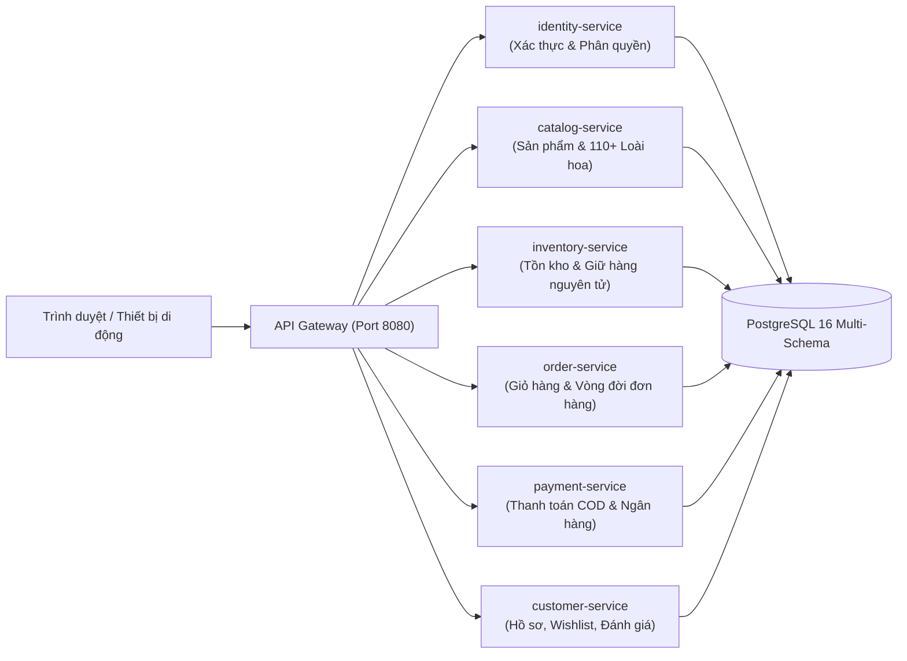

# FLORA — NỀN TẢNG THƯƠNG MẠI ĐIỆN TỬ HOA TƯƠI NGHỆ THUẬT & QUÀ TẶNG CAO CẤP
## TÀI LIỆU MÔ TẢ VẮN TẮT ĐỀ TÀI (EXECUTIVE PROJECT SUMMARY)

---

### 1. Thông Tin Chung Đề Tài
- **Tên đề tài**: Nghiên cứu, thiết kế và xây dựng Hệ thống Thương mại Điện tử Hoa tươi Nghệ thuật FLORA theo kiến trúc Microservices.
- **Lĩnh vực ứng dụng**: Thương mại điện tử chuyên biệt (Vertical E-Commerce), Bán lẻ hoa tươi & Quà tặng sự kiện cao cấp.
- **Mục tiêu chính**: Cung cấp giải pháp mua sắm hoa tươi trực tuyến toàn diện, cá nhân hóa cao, giải quyết triệt để các bài toán đặc thù của ngành hoa (hàng mau hỏng, cam kết giao hỏa tốc 2 giờ, giữ chỗ tồn kho tức thời, bộ lọc phân loại chuyên sâu).

---

### 2. Tính Cấp Thiết & Bối Cảnh Thực Tiễn
Ngành hoa tươi trực tuyến tại Việt Nam có tốc độ tăng trưởng cao nhưng gặp nhiều rào cản vận hành mà các sàn thương mại điện tử tổng hợp (Shopee, Lazada, Tiki) không đáp ứng tốt:
1. **Tính chất hàng mau hỏng (Perishable Goods)**: Hoa tươi cắm thủ công theo đơn, không thể lưu kho lâu ngày. Cần cơ chế khóa giữ tồn kho nguyên tử (`Atomic Stock Hold`) để tránh bán vượt quá số lượng hoa tươi có sẵn trong ngày.
2. **Yêu cầu giao hỏa tốc 2 giờ**: Khách hàng thường đặt hoa vào các sự kiện khẩn cấp (sinh nhật, khai trương, kỷ niệm). Luồng xử lý từ lúc đặt ➔ giữ hàng ➔ cắm hoa ➔ giao vận phải thông suốt theo thời gian thực.
3. **Cá nhân hóa sản phẩm & Thông điệp gửi trao**: Mỗi đơn hoa gắn liền với thông điệp viết thiệp tay, lời chúc mừng, banner khai trương và khung giờ giao định sẵn.
4. **Độ phức tạp trong tìm kiếm & lựa chọn**: Khách hàng cần tìm theo dịp trao tặng, theo tông màu sắc phong thủy, theo mức ngân sách hoặc tra cứu chính xác theo hơn 110+ loài hoa & giống hoa quý (Hồng Juliet David Austin, Mẫu đơn Peony, Tulip Hà Lan, Sen bách diệp...).

---

### 3. Mục Tiêu & Phạm Vi Đề Tài

#### 3.1. Mục tiêu công nghệ
- Áp dụng kiến trúc **Microservices chuẩn Domain-Driven Design (DDD)** với Java 21 LTS và Spring Boot 3.4.5.
- Tách biệt hoàn toàn cơ sở dữ liệu theo mô hình **Database-per-service** trên nền tảng PostgreSQL 16 (6 logical schemas độc lập, quản lý bằng Flyway migration).
- Xây dựng giao diện hiện đại, chuẩn SEO, tải trang siêu tốc với **Next.js 15 (App Router)**, **React 19** và **TypeScript**.
- Tự động hóa đóng gói và triển khai toàn bộ hệ sinh thái 9 container chỉ với **1 câu lệnh Docker Compose**.

#### 3.2. Phạm vi người dùng & Phân quyền (RBAC)
- **Khách hàng (Customer)**: Xem danh mục, lọc đa chiều, tìm kiếm theo 110+ giống hoa, thêm giỏ hàng, lưu danh sách yêu thích (Wishlist), đặt hàng giao 2h kèm lời chúc thiệp, thanh toán đa phương thức (COD, chuyển khoản VietQR), theo dõi trạng thái đơn hàng thời gian thực, đánh giá chất lượng kèm số sao sau khi nhận hoa.
- **Nhân viên tiệm hoa (Staff)**: Bảng điều khiển tiếp nhận đơn mới, chuyển trạng thái đơn hàng (Đang cắm hoa ➔ Đang giao ➔ Đã giao), xác nhận thanh toán chuyển khoản, kiểm tra thông tin người nhận và nội dung thiệp.
- **Quản trị viên (Admin)**: Dashboard thống kê doanh thu, tỷ lệ hoàn tất đơn hàng, quản lý danh mục sản phẩm (giá niêm yết, giá khuyến mãi), quản lý xuất nhập tồn kho nguyên tử, tạo và quản lý mã giảm giá (Voucher).

---

### 4. Kiến Trúc Hệ Thống & Ngăn Xếp Công Nghệ (Tech Stack)

#### 4.1. Ngăn xếp công nghệ
| Tầng kiến trúc | Công nghệ chủ đạo | Vai trò kỹ thuật |
| :--- | :--- | :--- |
| **Frontend** | Next.js 15.5.28, React 19, TypeScript | Server-Side Rendering (SSR), Server Actions, giao diện responsive mượt mà. |
| **API Gateway** | Spring Cloud Gateway 3.4.5 | Điểm đón tiếp duy nhất (Single Entry Point), định tuyến, xử lý CORS, phân phối tải. |
| **Backend Services** | Java 21 LTS, Spring Boot 3.4.5 | Virtual Threads, Spring Security 6, Spring Data JPA/JDBC, Bean Validation. |
| **Bảo mật & Auth** | JWT (JSON Web Token), BCrypt | Mã hóa mật khẩu, truyền token xác thực phân quyền chuẩn Stateless REST. |
| **Cơ sở dữ liệu** | PostgreSQL 16 (Alpine), Flyway 10 | 6 Schemas độc lập (`identity`, `catalog`, `inventory`, `order`, `payment`, `customer`). |
| **Đóng gói & Chạy** | Docker & Docker Compose v2 | Multi-stage build tối ưu kích thước image, điều phối 9 container tự động. |

#### 4.2. Sơ đồ phân rã dịch vụ Microservices

---

### 5. Điểm Nhấn Nghiệp Vụ & Đột Phá Kỹ Thuật

1. **Khóa giữ tồn kho nguyên tử (Atomic Stock Reservation)**:
   - Khi khách hàng tạo đơn hàng, hệ thống lập tức khóa giữ số lượng hoa tương ứng (`reserve stock`) trong thời gian chờ thanh toán/xử lý.
   - Công thức tồn kho an toàn: `Tồn khả dụng (available) = Tồn thực tế (on_hand) - Tồn đang giữ (reserved)`.
   - Đảm bảo tuyệt đối không xảy ra tình trạng bán vượt số lượng (Over-selling) khi có nhiều khách hàng cùng đặt một mẫu hoa hot.

2. **Hệ thống phân loại & Bộ lọc đa diện 110+ loài hoa**:
   - Tích hợp từ điển phân loại thực vật học hoa tươi với 110+ giống hoa, từ hoa nhập khẩu cao cấp đến hoa nội địa Đà Lạt.
   - Cho phép khách hàng lọc kết hợp linh hoạt: Theo danh mục thiết kế (Bó, Giỏ, Kệ, Hộp, Lan hồ điệp), theo Dịp tặng, theo Màu sắc phong thủy, theo Ngân sách nhanh (Dưới 500k, 500k-1tr, Trên 1tr), và tra cứu nhanh tên hoa.

3. **Cơ chế định giá 2 tầng & Khuyến mãi thông minh**:
   - Hỗ trợ hiển thị kép giữa Giá gốc niêm yết (`original_price`) và Giá ưu đãi (`price`) kèm huy hiệu giảm giá tự động `-X%`.
   - Kết hợp công cụ tính mã giảm giá (Voucher engine) theo phần trăm hoặc số tiền cố định, có điều kiện đơn tối thiểu và mức giảm tối đa.

4. **Xử lý bất đồng bộ chịu lỗi cao (Fault-Tolerant Next.js SSR)**:
   - Áp dụng kỹ thuật `Promise.allSettled` trên tầng Server Component của Next.js 15, kết hợp cùng cơ chế timeout nới lỏng. Đảm bảo toàn bộ 20 sản phẩm và danh mục bộ lọc luôn hiển thị tức thì, không bị lỗi trang trắng ngay cả khi mạng nội bộ container có độ trễ.

5. **Tính năng gắn kết người dùng**:
   - Danh sách hoa yêu thích (Wishlist) lưu trữ đồng bộ theo tài khoản.
   - Hệ thống đánh giá sao (1-5 sao) và nhận xét thực tế, ràng buộc chỉ cho phép đánh giá sau khi đơn hàng đã hoàn tất giao thành công.

---

### 6. Kết Quả Đạt Được & Ý Nghĩa Thực Tiễn
- **Về mặt kỹ thuật**: Xây dựng thành công một kiến trúc Microservices hoàn chỉnh, tuân thủ các nguyên tắc thiết kế phần mềm sạch (Clean Architecture, SOLID, Stateless REST API, Database-per-service).
- **Về mặt vận hành**: Đóng gói hoàn chỉnh thành một hệ thống "sẵn sàng chạy" (Turnkey solution), bất kỳ ai chỉ cần tải mã nguồn về và chạy lệnh `docker compose up -d` là toàn bộ cơ sở dữ liệu, backend và frontend đều tự động khởi tạo, nạp sẵn dữ liệu mẫu đầy đủ.
- **Về mặt kinh doanh**: Cung cấp một bản mẫu giải pháp (blueprint) chuẩn mực cho các chuỗi cửa hàng hoa tươi và quà tặng nghệ thuật muốn số hóa kênh bán lẻ với trải nghiệm người dùng cao cấp.
