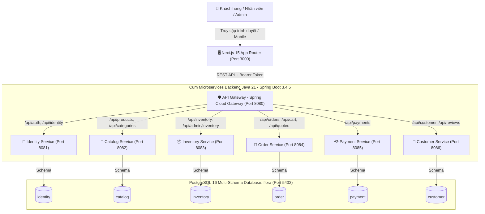
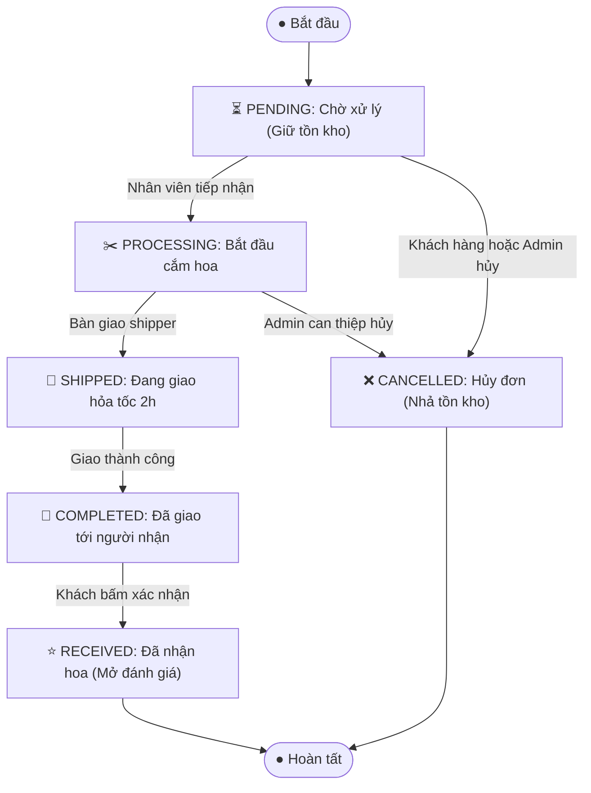

# FLORA — Nền Tảng Thương Mại Điện Tử Hoa Tươi Nghệ Thuật & Quà Tặng Cao Cấp

> **Hệ thống thương mại điện tử chuyên biệt ngành hoa tươi được thiết kế theo kiến trúc Microservices hiện đại, kết hợp giữa sức mạnh bảo mật của Java 21 / Spring Boot 3 và trải nghiệm người dùng tinh tế, mượt mà của Next.js 15 (App Router, React 19, TypeScript).**

---

## 📑 Mục Lục
1. [Giới thiệu tổng quan sản phẩm](#1-giới-thiệu-tổng-quan-sản-phẩm)
2. [Kiến trúc hệ thống & Sơ đồ luồng dữ liệu](#2-kiến-trúc-hệ-thống--sơ-đồ-luồng-dữ-liệu)
3. [Công nghệ sử dụng từ Frontend đến Backend](#3-công-nghệ-sử-dụng-từ-frontend-đến-backend)
4. [Bóc tách chi tiết các Microservices & Cơ sở dữ liệu](#4-bóc-tách-chi-tiết-các-microservices--cơ-sở-dữ-liệu)
5. [Quy trình nghiệp vụ cốt lõi (Business Workflows)](#5-quy-trình-nghiệp-vụ-cốt-lõi-business-workflows)
   - 5.1. Vòng đời đơn hàng (Order State Machine)
   - 5.2. Quản lý kho hoa nguyên tử (Atomic Stock Reservation)
   - 5.3. Định giá đa tầng: Giá niêm yết, Giá ưu đãi & Voucher
   - 5.4. Bộ lọc tìm kiếm thông minh 110+ loài hoa
   - 5.5. Đánh giá sản phẩm & Danh sách yêu thích (Wishlist)
6. [Cấu trúc thư mục dự án (Directory Structure)](#6-cấu-trúc-thư-mục-dự-án-directory-structure)
7. [Hướng dẫn cài đặt, chạy và dừng hệ thống cho người mới](#7-hướng-dẫn-cài-đặt-chạy-và-dừng-hệ-thống-cho-người-mới)
   - 7.1. Yêu cầu môi trường tiên quyết (Prerequisites)
   - 7.2. Khởi chạy 1 lệnh duy nhất với Docker Compose (Khuyên dùng)
   - 7.3. Cách kiểm tra trạng thái hoạt động và xem log
   - 7.4. Hướng dẫn dừng và dọn dẹp hệ thống (Stop & Down)
   - 7.5. Khởi chạy thủ công cho lập trình viên (Local Development)
8. [Tài khoản thử nghiệm & Phân quyền người dùng](#8-tài-khoản-thử-nghiệm--phân-quyền-người-dùng)
9. [Bảng ánh xạ Cổng dịch vụ, Swagger UI & API Docs](#9-bảng-ánh-xạ-cổng-dịch-vụ-swagger-ui--api-docs)
10. [Bộ kịch bản kiểm thử tự động (Automated Testing)](#10-bộ-kịch-bản-kiểm-thử-tự-động-automated-testing)
11. [Quy định nghiệp vụ cần lưu ý trước khi lên Production](#11-quy-định-nghiệp-vụ-cần-lưu-ý-trước-khi-lên-production)

---

## 1. Giới thiệu tổng quan sản phẩm

**FLORA** là nền tảng thương mại điện tử phục vụ khách hàng có nhu cầu gửi trao hoa tươi nghệ thuật trong các dịp đặc biệt (Sinh nhật, Tình yêu & Kỷ niệm, Khai trương, Cảm ơn, Hoa cưới, Chia buồn).

Khác với các mặt hàng tiêu dùng thông thường, ngành hoa tươi có các đặc thù nghiệp vụ chuyên biệt:
- **Tính thời gian thực và mau hỏng (Perishable Goods)**: Sản phẩm chỉ cắm sau khi khách đặt, yêu cầu cam kết **Giao hỏa tốc trong 2 giờ** và giữ tồn kho nguyên tử (`Atomic Stock Hold`) để tránh bán vượt số lượng hoa thực tế có trong ngày.
- **Tính cá nhân hóa cao**: Mỗi bó hoa thường đi kèm thông điệp viết thiệp tay, lời nhắn chúc mừng, và khung giờ giao hẹn trước (sáng, trưa, chiều, tối).
- **Phân loại hoa đa chiều**: Người mua tìm hoa theo dịp, theo ý nghĩa từng loài hoa (110+ giống hoa: David Austin, Peony, Tulip Hà Lan, Sen bách diệp...), theo bảng màu phong thủy hoặc theo ngân sách cá nhân.
- **Vận hành 3 bên khép kín**: Khách hàng đặt mua ➔ Nhân viên tiệm hoa tiếp nhận và thợ cắm hoa hoàn thiện ➔ Quản trị viên theo dõi doanh thu KPI, điều phối nhập xuất kho và phát hành voucher khuyến mãi.

---

## 2. Kiến trúc hệ thống & Sơ đồ luồng dữ liệu

Hệ thống được xây dựng hoàn toàn theo mô hình **Microservices** hướng module độc lập. Mỗi dịch vụ chịu trách nhiệm cho một miền nghiệp vụ riêng biệt (**Domain-Driven Design**), sở hữu schema cơ sở dữ liệu độc lập và không tồn tại Foreign Key xuyên dịch vụ (No Cross-Service Database Constraints).

### 2.1. Sơ đồ kiến trúc tổng thể (System Topology)



### 2.2. Giao tiếp an toàn giữa các dịch vụ (Inter-Service Communication)
- **Từ ngoài vào (North-South Traffic)**: Client gửi request tới **API Gateway** (`http://localhost:8080`). Gateway đảm nhiệm CORS, xác thực phân quyền qua JWT Bearer Token, sau đó chuyển tiếp (reverse-proxy) tới các service nội bộ.
- **Nội bộ giữa các service (East-West Traffic)**: Khi `order-service` cần kiểm tra tồn kho tại `inventory-service` hoặc lấy thông tin sản phẩm từ `catalog-service`, cuộc gọi được bảo vệ bằng header bí mật `X-Internal-Key` ngăn chặn hoàn toàn việc gọi trái phép từ bên ngoài mạng nội bộ.

---

## 3. Công nghệ sử dụng từ Frontend đến Backend

| Tầng hệ thống | Công nghệ | Phiên bản | Mô tả vai trò kỹ thuật |
| :--- | :--- | :--- | :--- |
| **Frontend** | **Next.js (App Router)** | `15.5.28` | Server-Side Rendering (SSR) & Server Actions cho hiệu năng cao và SEO tối ưu. |
| | **React** | `19.0.0` | Thư viện UI hiện đại nhất, hỗ trợ async components và transitions. |
| | **TypeScript** | `5.8.3` | Type-safety chặt chẽ cho toàn bộ models, API payloads và props. |
| | **Styling & Fonts** | CSS Modules / Vanilla CSS | Typography chuẩn sans-serif hiện đại: `Plus Jakarta Sans` & `Be Vietnam Pro`. |
| **API Gateway** | **Spring Cloud Gateway** | `3.4.5` | Điều hướng tập trung, Reverse Proxy, CORS pre-flight handler. |
| **Backend Services**| **Java LTS** | `21` | Ngôn ngữ hiện đại với Virtual Threads, Records, Pattern Matching. |
| | **Spring Boot** | `3.4.5` | Khung ứng dụng backend microservices tiêu chuẩn doanh nghiệp. |
| | **Spring Security** | `6.4.x` | Phân quyền vai trò `CUSTOMER`, `STAFF`, `ADMIN`, giải mã Token. |
| | **Spring Data JPA & JDBC**| `3.4.5` | Tầng truy xuất dữ liệu tối ưu, sử dụng JDBC Template cho các câu query hiệu năng cao. |
| | **Xử lý tiền tệ** | `BigDecimal` | Tuyệt đối không dùng `float`/`double`; lưu `NUMERIC(19,2)` trong SQL. |
| **Database** | **PostgreSQL** | `16-alpine` | RDBMS mạnh mẽ, phân tách 6 logical schemas riêng biệt cho từng service. |
| | **Flyway** | `10.x` | Tự động quản lý migration cấu trúc bảng (`V1` -> `V6`) độc lập mỗi service. |
| **Đóng gói & Chạy**| **Docker & Docker Compose**| `v2` | Multi-stage build giúp image nhẹ, khởi động cụm 9 containers bằng 1 câu lệnh. |

---

## 4. Bóc tách chi tiết các Microservices & Cơ sở dữ liệu

### 4.1. `api-gateway` (Port `8080`)
- **Nhiệm vụ**: Cổng tiếp nhận toàn bộ request từ người dùng và ứng dụng web.
- **Định tuyến (Routing)**:
  - `/api/auth/**` & `/api/identity/**` ➔ `identity-service:8081`
  - `/api/products/**`, `/api/categories/**`, `/api/occasions/**` ➔ `catalog-service:8082`
  - `/api/inventory/**` ➔ `inventory-service:8083`
  - `/api/orders/**`, `/api/cart/**`, `/api/quotes/**` ➔ `order-service:8084`
  - `/api/payments/**` ➔ `payment-service:8085`
  - `/api/customer/**`, `/api/reviews/**` ➔ `customer-service:8086`

### 4.2. `identity-service` (Port `8081` — Schema `identity`)
- **Nhiệm vụ**: Quản lý định danh người dùng, phiên đăng nhập và phân quyền truy cập.
- **Bảo mật**: Mật khẩu được băm bằng thuật toán **BCrypt (12 rounds)**.
- **Cơ chế Token**: Cấp phát mã `Session Bearer Token` định dạng UUID v4 có thời hạn lưu trong bảng `identity.user_sessions`. Khi đăng xuất, token bị thu hồi ngay lập tức.
- **Vai trò người dùng**:
  - `CUSTOMER`: Khách mua hàng, xem đơn, đánh giá sản phẩm.
  - `STAFF`: Nhân viên xử lý cắm hoa và bàn giao vận chuyển.
  - `ADMIN`: Quản trị viên toàn quyền hệ thống.

### 4.3. `catalog-service` (Port `8082` — Schema `catalog`)
- **Nhiệm vụ**: Quản lý thông tin tác phẩm hoa tươi, quy cách bó, hình ảnh minh họa và phân loại đa chiều.
- **Cấu trúc dữ liệu**:
  - `products`: Mã SKU, tên sản phẩm, slug thân thiện SEO, giá bán thực tế (`price`), giá niêm yết/gốc (`original_price`), quy cách kích thước (dài, rộng, cao, khối lượng).
  - `categories`: Danh mục kiểu dáng thiết kế (Hoa bó, Giỏ hoa tươi, Kệ khai trương, Hộp hoa nghệ thuật, Lan hồ điệp).
  - `flower_types`: Hơn **110 giống hoa** tuyển chọn (Hồng Juliet, Mẫu đơn Peony, Thược dược, Cát tường, Phi yến...).
  - `occasions`: Các dịp tặng (Sinh nhật, Tình yêu, Khai trương, Tri ân...).
  - `colors`: Phân loại tone màu sắc (Đỏ tình yêu, Pastel nhẹ nhàng, Xanh biển thanh mát...).

### 4.4. `inventory-service` (Port `8083` — Schema `inventory`)
- **Nhiệm vụ**: Quản lý số lượng tồn kho từng sản phẩm hoa tươi theo thời gian thực.
- **Bộ 3 chỉ số tồn kho**:
  > `Tồn khả dụng (available) = Tồn thực tế (on_hand) - Tồn đang giữ cho đơn chờ (reserved)`
- **Biến động kho (`stock_movements`)**: Mọi lần nhập hàng, giữ hàng cho đơn mới, giải phóng tồn khi hủy đơn hoặc điều chỉnh hao hụt đều được ghi vết lịch sử kèm lý do cụ thể.

### 4.5. `order-service` (Port `8084` — Schema `order`)
- **Nhiệm vụ**: Trái tim nghiệp vụ của hệ thống thương mại điện tử FLORA.
- **Báo giá giỏ hàng (`quotes`)**: Tính toán tổng tiền hàng, kiểm tra tính hợp lệ của mã giảm giá (Voucher), tính phụ phí giao hàng hỏa tốc và đưa ra bảng tổng tiền chính xác.
- **Chống trùng lặp đơn (`Idempotency-Key`)**: Mỗi giao dịch checkout bắt buộc kèm UUID Idempotency-Key. Nếu khách hàng vô tình bấm 2 lần hoặc mạng chập chờn, hệ thống chỉ tạo duy nhất 1 đơn hàng và trả về cùng kết quả.
- **Lưu vết giá mua (Product Snapshot)**: Khi đặt hàng, tên hoa, SKU và đơn giá tại thời điểm đó được lưu trực tiếp vào bảng `order.order_items`, đảm bảo việc đổi giá trong tương lai không làm sai lệch hóa đơn quá khứ.

### 4.6. `payment-service` (Port `8085` — Schema `payment`)
- **Nhiệm vụ**: Quản lý các giao dịch thanh toán và cổng thanh toán.
- **Phương thức hỗ trợ**:
  1. `COD` (Thanh toán tiền mặt khi nhận hoa): Mặc định tạo giao dịch ở trạng thái `PENDING_COLLECTION`, nhân viên giao hoa thu tiền và cập nhật `PAID`.
  2. `MOMO` (Cổng MoMo Sandbox Mock Adapter): Hỗ trợ sinh mã QR thanh toán giả lập, webhook callback cập nhật tức thời khi giao dịch thành công.

### 4.7. `customer-service` (Port `8086` — Schema `customer`)
- **Nhiệm vụ**: Chăm sóc trải nghiệm cá nhân hóa của khách hàng.
- **Chức năng chính**:
  - Hồ sơ khách hàng & Sổ địa chỉ nhận hoa (hỗ trợ chọn địa chỉ mặc định).
  - Danh sách hoa yêu thích (`wishlist`): Khách hàng bấm thả tim hoa để lưu lại và xem trong trang `/yeu-thich`.
  - Đánh giá hoa tươi (`reviews`): Đánh giá 1 - 5 sao và viết cảm nhận. Có cơ chế kiểm tra khách hàng **phải từng mua sản phẩm trong đơn đã giao thành công** mới được để lại đánh giá.

---

## 5. Quy trình nghiệp vụ cốt lõi (Business Workflows)

### 5.1. Vòng đời đơn hàng (Order State Machine)

Hệ thống quản lý trạng thái đơn hàng chặt chẽ qua 6 giai đoạn rõ ràng:



> [!IMPORTANT]
> **Quy định hủy đơn bảo vệ hoa tươi**:
> Khách hàng **chỉ được quyền tự hủy đơn trực tuyến khi đơn còn ở trạng thái `PENDING` (Chờ xử lý)**. Khi tiệm hoa đã chuyển sang `PROCESSING` (hoa đã được thợ cắt cành cắm vào xốp nghệ thuật), hệ thống tự động khóa nút hủy của khách để tránh hư hao nguyên vật liệu tươi sống.

### 5.2. Quản lý kho hoa nguyên tử (Atomic Stock Reservation)
1. Khi khách hàng bấm **Đặt hàng** tại `/thanh-toan`:
   - `order-service` gọi `inventory-service` bằng endpoint nội bộ:  
     `POST /api/inventory/reserve`
   - `inventory-service` kiểm tra: Nếu `available >= quantity` thì tăng `reserved += quantity`. Quá trình này được bảo vệ bởi câu lệnh SQL Update nguyên tử (`atomic UPDATE WHERE available >= requested`), loại bỏ triệt để nguy cơ Race Condition khi nhiều người cùng đặt bó hoa cuối cùng.
2. Nếu đơn hàng bị hủy (`CANCELLED`):
   - `order-service` tự động phát tín hiệu:  
     `POST /api/inventory/release`
   - `inventory-service` giảm `reserved -= quantity`, trả lại số hoa khả dụng cho người khác mua ngay lập tức mà không cần can thiệp thủ công.

### 5.3. Định giá đa tầng: Giá niêm yết, Giá ưu đãi & Voucher
Để kích thích mua sắm và tạo cảm giác nhận được giá trị xứng đáng, FLORA áp dụng cơ chế 3 mức giá minh bạch:
1. **Giá gốc / Giá niêm yết (`original_price`)**: Giá thị trường tham chiếu, được hiển thị gạch ngang (`strike-through`) với màu xám thanh lịch.
2. **Giá bán ưu đãi (`price`)**: Giá thực tế tại FLORA (thường rẻ hơn 15% - 25% so với giá gốc). Trên ảnh hoa có gắn huy hiệu giảm giá nổi bật (ví dụ: `-17%`, `-20%`).
3. **Mã giảm giá (Voucher Discount)**: Nhập mã khuyến mãi khi thanh toán:
   - `FLORANEW`: Giảm ngay 50.000 ₫ cho khách hàng mới.
   - `FLORA10`: Giảm 10% tổng đơn hàng (tối đa 100.000 ₫, đơn từ 300.000 ₫).
   - `FLORALOVE`: Giảm 80.000 ₫ cho các đơn hoa kỷ niệm & tình yêu từ 500.000 ₫.

### 5.4. Bộ lọc tìm kiếm thông minh 110+ loài hoa
Tại trang danh mục hoa tươi (`/san-pham`), người dùng có thể kết hợp đồng thời nhiều tiêu chí lọc mà không bị gián đoạn:
- **Lọc theo Dịp**: Sinh nhật, Khai trương, Tình yêu & Kỷ niệm, Cảm ơn & Tri ân, Hoa chia buồn.
- **Lọc theo 110+ giống hoa**: Hộp cuộn danh mục có thanh cuộn tinh gọn, hỗ trợ chọn từng giống hoa cụ thể (Baby trắng, Hồng Juliet, Cúc mẫu đơn, Lan hồ điệp...).
- **Lọc theo Màu sắc**: Trắng tinh khôi, Đỏ rực rỡ, Hồng ngọt ngào, Vàng ấm áp, Xanh pastel...
- **Lọc theo Khoảng ngân sách**: Dưới 500k, 500k - 1 triệu, 1 triệu - 2 triệu, Trên 2 triệu.

### 5.5. Đánh giá sản phẩm & Danh sách yêu thích (Wishlist)
- **Yêu thích (Wishlist)**: Khách hàng có thể lưu lại những tác phẩm hoa ưng ý bằng nút Thả tim `♥` tại trang chi tiết, sau đó dễ dàng xem lại toàn bộ danh sách tại `/yeu-thich`.
- **Đánh giá thực tế**: Đánh giá chỉ được mở cho những khách hàng đã thực sự đặt mua đơn hàng đó (trạng thái `COMPLETED` hoặc `RECEIVED`), đảm bảo 100% đánh giá là người thật việc thật.

---

## 6. Cấu trúc thư mục dự án (Directory Structure)

```
d:/cua_hang_hoa_flora/
├── backend/                               # Cụm Microservices Java 21 / Spring Boot 3
│   ├── api-gateway/                       # Cổng điều hướng tập trung (Port 8080)
│   ├── identity-service/                  # Đăng ký, đăng nhập, JWT sessions (Port 8081)
│   ├── catalog-service/                   # Quản lý 20+ tác phẩm hoa, 110 giống hoa (Port 8082)
│   ├── inventory-service/                 # Quản lý tồn kho hoa tươi & giữ hàng (Port 8083)
│   ├── order-service/                     # Giỏ hàng, báo giá, tạo đơn, voucher (Port 8084)
│   ├── payment-service/                   # Quản lý giao dịch COD & MoMo Mock (Port 8085)
│   └── customer-service/                  # Sổ địa chỉ, Wishlist, Đánh giá sản phẩm (Port 8086)
│
├── frontend/                              # Ứng dụng Web Next.js 15 (Port 3000)
│   ├── app/                               # App Router cấu trúc theo chuẩn Next.js
│   │   ├── (auth)/                        # Nhóm giao diện xác thực tách biệt
│   │   │   ├── dang-nhap/page.tsx         # Màn hình Đăng nhập riêng biệt
│   │   │   └── dang-ky/page.tsx           # Màn hình Đăng ký tài khoản mới riêng biệt
│   │   ├── san-pham/                      # Trang danh mục & bộ lọc hoa tươi
│   │   │   └── [id]/page.tsx              # Chi tiết bó hoa, giá gốc & giá ưu đãi, đánh giá
│   │   ├── gio-hang/page.tsx              # Giỏ hàng, tăng giảm số lượng
│   │   ├── thanh-toan/                    # Đặt hàng, chọn ngày giờ giao, nhập voucher
│   │   │   └── [id]/page.tsx              # Trang xác nhận đơn & mã QR MoMo Sandbox
│   │   ├── don-hang/                      # Quản lý đơn hàng của tôi, hủy đơn, xác nhận
│   │   │   └── [id]/page.tsx              # Chi tiết đơn hàng, lịch sử chuyển trạng thái
│   │   ├── yeu-thich/page.tsx             # Danh sách các bó hoa khách đã thả tim
│   │   ├── danh-gia/[orderItemId]/        # Form gửi cảm nhận và chấm sao cho hoa
│   │   ├── nhan-vien/page.tsx             # Giao diện dành cho nhân viên xử lý cắm hoa
│   │   ├── admin/                         # Bảng điều khiển quản trị viên
│   │   │   ├── page.tsx                   # Báo cáo doanh thu KPI tổng quan
│   │   │   ├── san-pham/page.tsx          # Thêm mới / cập nhật sản phẩm hoa
│   │   │   ├── ton-kho/page.tsx           # Điều chỉnh tồn kho thực tế, nhập xuất hao hụt
│   │   │   ├── vouchers/page.tsx          # Tạo và quản lý mã giảm giá
│   │   │   └── don-hang/page.tsx          # Can thiệp chuyển trạng thái đơn, xử lý hoàn tiền
│   │   ├── layout.tsx                     # Header thương hiệu, Thanh tìm kiếm, Footer
│   │   ├── style.css                      # Toàn bộ CSS phong cách hoa tươi hiện đại
│   │   └── actions.ts                     # Server Actions xử lý form đăng nhập, giỏ hàng
│   ├── components/                        # Các linh kiện tái sử dụng (ProductCard, v.v.)
│   └── lib/                               # SDK kết nối API Gateway, types & helpers
│
├── scripts/                               # Các kịch bản tự động hóa kiểm thử
│   ├── test.ps1                           # Kiểm thử toàn bộ hệ thống (Maven + NPM Build)
│   └── test-cod-http.ps1                  # Kịch bản kiểm thử luồng đặt đơn COD thực tế
│
├── docker-compose.yml                     # Cấu hình cụm 9 container chạy đồng bộ
├── .env.example                           # Mẫu biến môi trường cấu hình cổng, mật khẩu DB
└── README.md                              # Tài liệu hướng dẫn toàn diện này
```

---

## 7. Hướng dẫn cài đặt, chạy và dừng hệ thống cho người mới

### 7.1. Yêu cầu môi trường tiên quyết (Prerequisites)
Trước khi bắt đầu, hãy đảm bảo máy tính của bạn đã cài đặt:
1. **Docker Desktop** (bắt buộc): Đã bật và đang chạy (hỗ trợ Docker Compose v2).
2. **RAM khả dụng**: Khuyến nghị tối thiểu **4 GB RAM trống** để vận hành trơn tru cả cụm 9 container.
3. *(Tùy chọn — chỉ khi muốn chạy không qua Docker)*: **Java 21 LTS**, **Maven 3.9+**, **Node.js 20+**.

---

### 7.2. Khởi chạy 1 lệnh duy nhất với Docker Compose (Khuyên dùng)

Đây là cách đơn giản và an toàn nhất, hệ thống sẽ tự động cấu hình cơ sở dữ liệu PostgreSQL, chạy Flyway migration để tạo toàn bộ bảng dữ liệu, biên dịch 7 microservices Java và ứng dụng Next.js.

Mở terminal (PowerShell trên Windows, hoặc Terminal trên macOS/Linux) tại thư mục gốc của dự án:

```bash
# Bước 1: Sao chép file biến môi trường mẫu (nếu chưa có file .env)
cp .env.example .env

# Bước 2: Khởi động toàn bộ 9 container ngầm trong nền
docker compose up -d --build
```

Quá trình build và khởi động lần đầu sẽ mất khoảng 2 - 3 phút để tải base image và biên dịch mã nguồn.

Sau khi lệnh hoàn tất, toàn bộ hệ thống đã sẵn sàng phục vụ tại:
- **Website FLORA**: [http://localhost:3000](http://localhost:3000)
- **API Gateway**: [http://localhost:8080](http://localhost:8080)

---

### 7.3. Cách kiểm tra trạng thái hoạt động và xem log

#### Kiểm tra danh sách container đang chạy:
```bash
docker compose ps
```
Bạn sẽ thấy đầy đủ **9 container** đều ở trạng thái `Up`:
- `cua_hang_hoa_flora-postgres-1` (Cơ sở dữ liệu)
- `cua_hang_hoa_flora-api-gateway-1` (Cổng API)
- `cua_hang_hoa_flora-identity-1` (Xác thực người dùng)
- `cua_hang_hoa_flora-catalog-1` (Danh mục sản phẩm hoa)
- `cua_hang_hoa_flora-inventory-1` (Quản lý kho hoa)
- `cua_hang_hoa_flora-order-1` (Đơn hàng & giỏ hàng)
- `cua_hang_hoa_flora-payment-1` (Thanh toán)
- `cua_hang_hoa_flora-customer-1` (Khách hàng & đánh giá)
- `cua_hang_hoa_flora-frontend-1` (Giao diện người dùng)

#### Xem log của toàn hệ thống theo thời gian thực:
```bash
docker compose logs -f
```

#### Xem log của riêng một dịch vụ cụ thể (Ví dụ xem log của order-service hoặc frontend):
```bash
docker compose logs -f order
docker compose logs -f frontend
docker compose logs -f catalog
```
*(Bấm `Ctrl + C` để thoát màn hình theo dõi log)*.

---

### 7.4. Hướng dẫn dừng và dọn dẹp hệ thống (Stop & Down)

Khi không sử dụng hoặc muốn giải phóng tài nguyên máy tính, bạn thực hiện như sau:

#### Lựa chọn 1: Dừng tạm thời hệ thống (Dữ liệu và container được bảo lưu)
```bash
docker compose stop
```
*(Khi muốn tiếp tục dùng lại, chỉ cần gõ `docker compose start` mà không cần build lại)*.

#### Lựa chọn 2: Dừng hoàn toàn và gỡ bỏ containers (Khuyên dùng)
```bash
docker compose down
```
Lệnh này sẽ dừng an toàn tất cả 9 container và ngắt mạng nội bộ. Toàn bộ dữ liệu cơ sở dữ liệu PostgreSQL (các sản phẩm, đơn hàng, tài khoản) vẫn được lưu trữ an toàn trong Docker Volume.

#### Lựa chọn 3: Reset toàn bộ hệ thống về trạng thái ban đầu (Xóa trắng dữ liệu)
Nếu bạn muốn xóa sạch dữ liệu đơn hàng test để database quay về trạng thái hạt giống ban đầu:
```bash
docker compose down -v
```
*(Cờ `-v` sẽ xóa sạch các Docker Volume chứa dữ liệu database)*.

---

### 7.5. Khởi chạy thủ công cho lập trình viên (Local Development)

Nếu bạn là lập trình viên muốn chỉnh sửa code và xem thay đổi ngay mà không cần rebuild container:

1. **Khởi chạy chỉ riêng cơ sở dữ liệu PostgreSQL qua Docker**:
   ```bash
   docker compose up -d postgres
   ```
2. **Chạy các service backend mong muốn**:
   Đi vào thư mục service (ví dụ `backend/catalog-service`) và chạy:
   ```bash
   mvn spring-boot:run
   ```
3. **Chạy ứng dụng Frontend Next.js**:
   Mở terminal tại thư mục `frontend`:
   ```bash
   npm install
   npm run dev
   ```
   Giao diện chạy chế độ Hot-Reload tại [http://localhost:3000](http://localhost:3000).

---

## 8. Tài khoản thử nghiệm & Phân quyền người dùng

Hệ thống đã nạp sẵn hạt giống dữ liệu (Seeds) cho 3 nhóm vai trò nghiệp vụ. Bạn có thể đăng nhập trực tiếp tại trang [http://localhost:3000/dang-nhap](http://localhost:3000/dang-nhap):

| Vai trò | Email đăng nhập | Mật khẩu chung | Các trang được phép truy cập | Trải nghiệm kiểm thử chính |
| :--- | :--- | :--- | :--- | :--- |
| 🌸 **Khách hàng** (`CUSTOMER`) | `customer@flora.vn` | `Password123@` | `/`, `/san-pham`, `/gio-hang`, `/thanh-toan`, `/don-hang`, `/yeu-thich` | Lọc hoa theo 110 loài, đặt đơn COD/MoMo, nhập mã voucher `FLORANEW`, hủy đơn chờ xử lý, nhận hoa, đánh giá ★★★★★. |
| 🌿 **Nhân viên** (`STAFF`) | `staff@flora.vn` | `Password123@` | `/nhan-vien`, cùng các trang công khai | Tiếp nhận đơn đặt, chuyển trạng thái `Chờ xử lý ➔ Đang cắm hoa ➔ Đang giao ➔ Đã giao`. |
| 👑 **Quản trị viên** (`ADMIN`) | `admin@flora.vn` | `Password123@` | `/admin`, `/admin/san-pham`, `/admin/ton-kho`, `/admin/vouchers`, `/admin/don-hang` | Xem biểu đồ KPI doanh thu, thêm/sửa hoa tươi, nhập thêm tồn kho hoa, tạo voucher khuyến mãi mới, xử lý hoàn tiền đơn hủy. |

> [!NOTE]
> Giao diện Đăng nhập và Đăng ký đã được tách riêng biệt tại 2 đường dẫn độc lập:
> - Đăng nhập: [http://localhost:3000/dang-nhap](http://localhost:3000/dang-nhap)
> - Đăng ký tài khoản mới: [http://localhost:3000/dang-ky](http://localhost:3000/dang-ky)

---

## 9. Bảng ánh xạ Cổng dịch vụ, Swagger UI & API Docs

Mỗi microservice đều tích hợp sẵn bộ tài liệu **OpenAPI 3 / Swagger UI**, cho phép bạn kiểm tra và gọi thử API trực tiếp trên trình duyệt:

| Dịch vụ | Cổng nội bộ | Địa chỉ Swagger UI | Đường dẫn API Schema JSON |
| :--- | :---: | :--- | :--- |
| **API Gateway** | `8080` | [http://localhost:8080/swagger-ui.html](http://localhost:8080/swagger-ui.html) | `http://localhost:8080/v3/api-docs` |
| **Identity Service** | `8081` | [http://localhost:8081/swagger-ui.html](http://localhost:8081/swagger-ui.html) | `http://localhost:8081/v3/api-docs` |
| **Catalog Service** | `8082` | [http://localhost:8082/swagger-ui.html](http://localhost:8082/swagger-ui.html) | `http://localhost:8082/v3/api-docs` |
| **Inventory Service** | `8083` | [http://localhost:8083/swagger-ui.html](http://localhost:8083/swagger-ui.html) | `http://localhost:8083/v3/api-docs` |
| **Order Service** | `8084` | [http://localhost:8084/swagger-ui.html](http://localhost:8084/swagger-ui.html) | `http://localhost:8084/v3/api-docs` |
| **Payment Service** | `8085` | [http://localhost:8085/swagger-ui.html](http://localhost:8085/swagger-ui.html) | `http://localhost:8085/v3/api-docs` |
| **Customer Service** | `8086` | [http://localhost:8086/swagger-ui.html](http://localhost:8086/swagger-ui.html) | `http://localhost:8086/v3/api-docs` |
| **PostgreSQL Database**| `5432` | *(Kết nối qua DBeaver / pgAdmin với user: `flora`, db: `flora`)* | — |
| **Web Frontend** | `3000` | [http://localhost:3000](http://localhost:3000) | — |

---

## 10. Bộ kịch bản kiểm thử tự động (Automated Testing)

Dự án cung cấp sẵn các kịch bản PowerShell giúp kiểm tra chất lượng code tự động từ đầu đến cuối:

### 1. Kiểm thử tích hợp toàn diện hệ thống:
```powershell
& scripts/test.ps1
```
Kịch bản sẽ tự động duyệt qua tất cả 7 service backend để chạy toàn bộ các test case Java JUnit/Mockito, kiểm tra cú pháp cấu hình Docker, và chạy lệnh `next build` xác thực tính hợp lệ về kiểu dữ liệu TypeScript của Frontend.

### 2. Kiểm thử luồng đặt đơn COD và giữ tồn kho thực tế:
Khi hệ thống đang chạy (`docker compose ps` báo Up), thực thi:
```powershell
& scripts/test-cod-http.ps1
```
Kịch bản thực hiện kiểm thử tự động chu trình khép kín:
1. Đăng ký một tài khoản khách hàng mới ngẫu nhiên.
2. Thêm hoa vào giỏ, tạo báo giá và đặt đơn hàng COD kèm Idempotency-Key.
3. Kiểm tra tính Idempotent (gửi lại request cùng key không tạo thêm đơn mới và không trừ tồn kho lần 2).
4. Xác minh lượng hoa đã được chuyển sang trạng thái `HELD` trong `inventory`.
5. Thực hiện hủy đơn hàng và kiểm tra tồn kho được nhả lại thành công.
6. Xóa sạch dữ liệu thử nghiệm, không làm bẩn database.

---

## 11. Quy định nghiệp vụ cần lưu ý trước khi lên Production

1. **Khóa quyền hủy đơn khi hoa đã cắm**:
   - Hiện tại hệ thống tự động khóa tính năng tự hủy của khách khi đơn đạt `PROCESSING`. Trên môi trường thực tế, nếu khách khăng khăng hủy qua điện thoại, quản trị viên sử dụng trang `/admin/don-hang` để hủy cưỡng chế và ghi nhận phí phạt vật liệu cắm hoa.
2. **Cơ chế thu hồi tồn kho giữ chỗ (Stock Hold TTL)**:
   - Các đơn hàng thanh toán trực tuyến chưa hoàn tất sau 30 phút nên được quét bởi một tác vụ định kỳ (`Scheduled Worker`) để tự động chuyển sang `CANCELLED` và nhả lại tồn cho khách hàng khác.
3. **Quy trình gửi ảnh thật trước khi giao hoa**:
   - Trong ngành hoa tươi cao cấp, trước khi shipper xuất phát, cửa hàng nên chụp ảnh sản phẩm thật hoàn thiện và gửi qua Zalo/Email cho người đặt duyệt hình thức.

---

**FLORA — Gửi trọn yêu thương qua từng cánh hoa.** 💐  
*Mã nguồn được duy trì và phát triển với tiêu chuẩn chất lượng cao nhất.*
